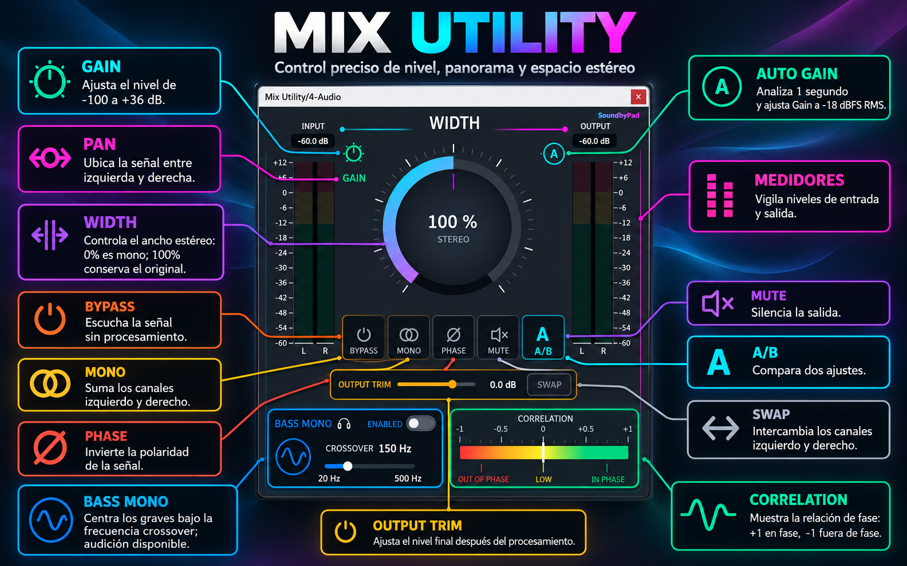

# Mix Utility

**Mix Utility** is a free stereo utility VST3 developed by **SoundbyPad**. It brings essential stereo, level, and monitoring controls together in one compact plugin.

## Features

- **Gain**: adjust the signal from -100 dB to +36 dB, with visual CUT, UNITY, and BOOST states.
- **Pan**: position the signal between left and right.
- **Width**: control stereo width from mono to 400%. Width is constrained when Mono is active.
- **Auto Gain**: analyze the signal for one second and set Gain toward -18 dBFS RMS.
- **Input and output meters**: monitor left and right channel levels.
- **Bypass, Mono, Phase, and Mute**: quickly check or change the signal.
- **A/B**: compare two sets of settings.
- **Output Trim**: adjust the final output level after processing.
- **Stereo Swap**: exchange the left and right output channels.
- **Bass Mono**: mono the low frequencies with an adjustable crossover and audition option.
- **Correlation meter**: monitor stereo phase correlation.

## Compatibility

- **Operating system:** Windows 64-bit
- **Plugin format:** VST3
- A compatible VST3 host is required.

This download is not compatible with macOS or Linux. Those systems require their own builds.

## Installation

1. Download the latest Windows VST3 package from the [GitHub Releases](https://github.com/David-29s/Mix-utility/releases) page.
2. Close your DAW and copy the complete `Mix Utility.vst3` folder into:
   `C:\Program Files\Common Files\VST3`
3. Reopen your DAW and rescan VST3 plugins if needed.

## Build from source

The project uses CMake and JUCE. Open the repository in CLion, let CMake configure the project, and build the `AudioPluginExample_VST3` target in the desired configuration. Use **Release** for a distributable build.

## Credits and license

Mix Utility was developed by **SoundbyPad**. The downloadable package includes the applicable license terms.

